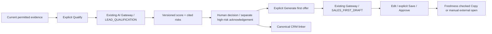

# AI Lead Qualification and Candidate Outreach Preparation — Prompt №8

Local implementation, 2026-11-01 Europe/Warsaw. Feature flag defaults off. No production migration, real channel collection, paid model benchmark, Telegram send or release was executed. Local mocks establish contract/policy behavior, not real-model quality or production readiness.

## Architecture and workflow

The existing Discovery source registry, classification/extraction and candidate identity remain canonical. Qualification never restarts classification/extraction, discovers channels, joins a Telegram account or creates a conversation. `TelegramAdvertiser` remains the sole CRM client. Existing CRM status, DNC, source eligibility, human decisions and AI recommendations are independent.

Candidate workflow is derived from existing human rejection/risk/link facts and the new qualification dimension: NEW, NEEDS_REVIEW, QUALIFIED, LOW_RELEVANCE, SUSPICIOUS, REJECTED, LINKED. Human rejection and DNC survive rediscovery and every AI result. High priority is an explainable review filter, not permission to contact anyone. A model risk signal never creates a public accusation or customer blacklist.

`TelegramCrmAiDraft` still requires a real conversation/contact and retains its existing send guard. Two minimal candidate business records were added instead of weakening that FK: `TelegramLeadQualification` and `TelegramLeadCandidateDraft`. They reference the candidate through composite workspace FKs and existing Operations AI receipts, not a second token ledger. Candidate has five nullable human qualification/acknowledgement fields. Artifacts contain selected IDs, hashes and compact checks; no repeated full advertisement/prompt transcript is stored.

The main agent fixed contracts/schema first. Grace mapped actual runtime paths; Parnas/Knuth checked structure and costs; backend/frontend writers own separate files; Turing performs the read-only final integration review. No product implementation entered Shared Chat UI, consumer Finance, Bot Support or Telegram protocol adapters.

## Context, identity and eligibility

Each explicit operation uses a bounded candidate projection: at most five current, nondeleted, nonrejected, unexpired observations, 10,000 text characters in total, twelve confirmed strong public business contacts and five explicitly selected real products. Each selected source passes existing exact Discovery AI processing grants. Historical `sourceIds` alone are not disclosure permission. No website/profile fetch, Instagram Direct or private-profile scraping occurs.

Confirmed contact identity must remain literally present in current permitted material; a generic old evidence phrase cannot preserve a replaced username. Agency and destination references do not prove advertiser ownership. The existing exact-identity CRM matcher/linker checks all confirmed identities, ambiguity, current client ownership, DNC/CLOSED/archive and never creates a peer/thread. Past purchases are read only for a proven linked client with existing own/any CRM and Sales authorization. Unlinked candidates do not inherit another owner's private sales history.

Catalog facts come from existing Package Sales Context. Fixed channel prices are not a canonical package total; missing quotes, audiences and statistics remain missing. No quote calculator or fabricated reach was added. Missing real product/channel context produces insufficient evidence rather than a precise fit assertion.

`INTERNAL_LEAD_QUALIFICATION_ENABLED` must equal `true`; Discovery and existing Operations AI flags, category budgets, execute permission and reviewed source grants are also required. View, review and analyze capabilities reuse the existing leads permissions. Linked-client reads additionally respect CRM own/any scope. Draft edits/approval belong to the author; viewing another workspace is never permitted.

## Qualification and scoring policy

`LEAD_QUALIFICATION` uses a strict versioned structured schema: relevance, thematic fit, advertiser identity, evidence quality, recommended offer, cited reasons, risk signals and missing facts. Every reason/risk cites a selected observation ID and short literal quote; unknown IDs/invented quotes are rejected. It has no sensitive personal attributes, purchase probability, payment proof, tools or send capability. Advertisement text is untrusted data and cannot modify instructions or permissions.

The policy is a starting business heuristic, not calibrated purchase likelihood:

| Factor | Default maximum |
| --- | ---: |
| Relevance | 25 |
| Verified product/channel thematic fit | 25 |
| Confirmed business contact | 15 |
| Commercial offer | 10 |
| Evidence quality | 10 |
| Freshness | 10 |
| Repeated current evidence | 5 |

Separate relevance, evidence quality, risk level and overall priority are shown with factor explanations. Missing contact, insufficient evidence, unknown relevance/theme or absent verified product context yields `INSUFFICIENT_EVIDENCE` and null scores. Default high/medium risk penalties are40/20; qualification threshold65, high-priority threshold80. Risk signals are `RISK_LOW`, `RISK_MEDIUM`, `RISK_HIGH`, `RISK_UNKNOWN`; supported codes cover guaranteed returns, financial guarantees, contradictions, suspicious links, opaque offers, prohibited categories and insufficient data. No unsafe link is opened to investigate a signal.

The default version is `lead-qualification-v1`. A reviewed deployment JSON `INTERNAL_LEAD_QUALIFICATION_POLICY` can replace it only with a different version, all seven bounded integer weights summing100 and valid thresholds/penalties. This explicit configuration boundary is immutable for an operation. Policy changes invalidate fingerprints; they do not retroactively rewrite old scores or trigger paid regeneration. The synthetic corpus tests the policy; a labeled human evaluation must validate business usefulness before rollout.

High-risk approval needs a separate manager acknowledgement and meaningful note, bound to the current qualification/context. AI cannot cancel a human rejection or DNC. Human qualification can differ from the recommendation but does not silently erase evidence/risk indicators.

## Draft lifecycle and manual transport boundary

Candidate first offers use existing `SALES_FIRST_DRAFT`, common Copilot instructions, fact/provenance validation and conservative financial guards. No artificial financial category is added. Defaults: Ukrainian and NATURAL; CONSULTATIVE and DIRECT remain available without pressure. AUTO also falls back to Ukrainian for candidate preparation. Prompts request a specific, natural opening and factual package-placement proposal without flattery, invented prior relationships, conversion guarantees or unsupported statistics/prices.

Qualification and draft generation are separate explicit actions. No automatic batch AI, follow-on first offer, list-open AI, paid retries or per-factor calls exist. Selected products and current facts are reused. Fresh same-context qualification/draft reuse returns without a provider request. Durable claims precede Gateway execution; UNKNOWN/interrupted paid attempts retain reconciliation protection. Operation IDs are date-prefixed UUIDs; a changed request cannot reuse an existing operation ID as a new paid call.

Seven-day artifact TTL matches Copilot. Claims are capped at20 qualification records/candidate and20 drafts/candidate/author. The original full ad text remains in Observation only. Textarea changes remain browser memory until explicit Save; no keystroke persistence or independent localStorage draft lifecycle was added. Save removes approval; identical Save/Approve is a no-op. Approval binds current text, revision, context and current human qualification/risk decision, not merely a prior generated string.

Fingerprints include actual candidate identities/review facts, evidence hashes/classification versions, source scope/grants, selected product price/currency/update facts, linked identity/DNC/ownership, receipts and policy version. They exclude request ID and arbitrary wall-clock timestamps; freshness uses a bounded age bucket. Changed ad/contact/source/price, expired evidence or revoked permissions computes STALE/REVIEW_REQUIRED on read without a DB write or automatic AI. Revoking/replacing the human qualification also invalidates old outreach approval. Copy rechecks server freshness rather than trusting a cached UI button.

Candidate drafts expose only Copy/Open externally after current approval. Linking to a CRM client preserves acquisition references and allows the current preparation summary to be opened from that client. It does not create a Telegram conversation or authorize internal send. When a real conversation appears, the existing peer/client identity link remains canonical; the ordinary conversation Copilot/send path still enforces current permissions, DNC, account ownership, transport, source policy and conversation-scoped approval. This stage does not implement a one-click candidate-draft-to-conversation transfer that would bypass those guards. A future transfer must explicitly bind the real conversation/contact and reapprove against its current context.

## API and UI

Base `/telegram-crm/lead-discovery`; serializable contracts in `packages/shared/src/types/telegram-lead-qualification.ts`.

| Route | Behavior |
| --- | --- |
| GET `preparation/queue` | Cursor candidates with workflow/high-priority filters before pagination; no per-row AI request |
| GET `preparation/products` | Existing bounded product catalog, explicit open |
| GET `candidates/:id/preparation` | Current qualification, up to five own drafts, selected products and authoritative capabilities |
| POST `candidates/:id/qualify` | `{operationId, productIds<=5}` |
| PATCH `candidates/:id/qualification-decision` | Revision/qualification/context-bound human decision and risk acknowledgement |
| POST `candidates/:id/drafts` | Explicit `{operationId,productIds,tone,language}` using SALES_FIRST_DRAFT |
| PATCH `candidates/:id/drafts/:draftId` | Revision-bound Save/Approve/Discard |
| GET `contacts/:contactId/preparations` | Bounded proven acquisition candidates under current CRM authorization |

Mutation responses reconcile exact preparation keys; derived queue membership/source metrics use narrow invalidation. Evidence remains excluded from persisted browser query data. No polling/refetch interval or write on card open exists.

Desktop uses a candidate queue, evidence/contacts and qualification/risk/offer panes. Mobile switches list→single detail screen; no compressed three-column view. Existing confirmation, contact review, canonical CRM create/link, source navigation and bounded bulk review are reused. Bulk actions require confirmation and never generate or send AI in bulk. Loading, empty, error, denied, stale and unknown-cost states are explicit. Browser acceptance covers320/360/390/768/1024/1440px, keyboard focus and scroll.

## AI Usage and notifications

Classification and extraction remain their existing categories; qualification is `LEAD_QUALIFICATION`; candidate preparation is `SALES_FIRST_DRAFT` with a candidate-draft business-object identity. All use existing configured model/tariff snapshots, budget admission, usage receipts and UNKNOWN reservations. The Usage dashboard therefore separates the financial categories without another ledger; candidate business-object metadata distinguishes first-offer preparation from conversation Copilot. AI Usage request history exposes a candidate-first-offer filter and row label; its server query selects only SALES_FIRST_DRAFT receipts with the candidate namespace. The category aggregate above intentionally retains its selected financial scope, as the UI explains; no unsupported candidate-only daily-cube total is fabricated.

The reserved `CRM_AI_LEAD_QUALIFIED` enum/preferences/push formatter does not yet have candidate visibility or delivery policy. Its toggle remains disabled and this stage emits no notification. Safely enabling it requires a candidate visibility key, current workspace/role/qualification/human-approval/source/DNC delivery recheck, exact candidate deep-link coordinator and per-approval grouping/idempotency through existing Operations Notifications. Publishing the reserved enum alone would leak or misroute candidate data. The prompt explicitly permits this documented minimal extension; no separate push transport or post/open-triggered alert is added.

## Source-level SQL, token and runtime costs

These are logical Prisma/raw calls and source bounds, not measured Neon bills, physical SQL statements, query plans, latency or Railway RSS. One complete selected-product context build uses5 logical reads unlinked or8 linked (candidate, exact identity, own-source catalog, selected products/channel facts, plus linked authorization/purchases). Final action counts include the authoritative returned preparation view:

| Action | Calls unlinked / linked | Steady mutations | Provider requests |
| --- | ---: | ---: | ---: |
| New qualification | 54 / 66 | 13 | 2 |
| New first draft | 57 / 69 | 13 | 2 |
| Reuse qualification, new request ID | 16 / 22 | 0 | 0 |
| Reuse draft, new request ID | 17 / 23 | 0 | 0 |
| Changed Save / Discard | 15 / 21 | 1 | 0 |
| Approve | 16 / 22 | 1 | 0 |
| Human qualification decision | 15 / 21 | 1 | 0 |
| Unchanged Save | 14 / 20 | 0 | 0 |
| Unchanged Approve | 15 / 21 | 0 | 0 |
| Candidate Reject | 6–7 | 1 | 0 |
| Link existing CRM client | 8–9 | 1 | 0 |
| Create CRM client | 9–10 | 2 logical, plus up to12 nested contact rows | 0 |

Exact-operation replay costs one fewer call than new-ID reuse. Every fresh stage forces three authorization graph refreshes, excluded from these totals. First budget initialization can add four bucket rows for one category, six distinct rows across both categories in the same workspace. These are additional row mutations, not additional assumed Prisma calls.

| Candidates/day, both stages | Calls unlinked–linked | Steady mutations | Provider requests | Forced graph refreshes |
| --- | ---: | ---: | ---: | ---: |
| 0 | 0 | 0 | 0 | 0 |
| 50 | 5,550–6,750 | 1,300 | 200 | 300 |
| 500 | 55,500–67,500 | 13,000 | 2,000 | 3,000 |
| 2,000 | 222,000–270,000 | 52,000 | 8,000 | 12,000 |

The queue uses four bounded logical reads with Telegram source eligibility (three for manual-only sources), not a call per row. Derived SQL freshness filters inspect matching candidates before pagination, including latest qualification and selected evidence/product/channel references. A newly matching CRM identity/DNC for an unlinked candidate can temporarily leave queue summaries/source metrics optimistic: collection projections do not perform an exact identity search per candidate. Authoritative detail, qualification, approval and Copy always recheck current identity/DNC and block the action. This is a known collection-consistency limit, not permission to contact.

Source analytics adds up to two bounded eligibility reads when this feature is enabled; flag-off adds none. Request-history candidate filtering adds a predicate to the existing one-query cursor path, no extra ledger read. Index fan-out, expired/rejected evidence scanning and current administrator links require staging EXPLAIN; bounded roundtrips do not mean constant scanned rows.
 Existing Gateway alone adds24 data calls /11 steady mutations per successful stage and two provider requests (counter+generation), excluding authorization graph loads/transaction protocol. Two fresh stages start at48 calls/22 mutations before bounded business context, claims/results and view reconciliation. They do not rerun the previous62-call classification/extraction path.

No new Railway service, worker, Telegram handle/subscription, recurring poll, idle AI or per-channel timer exists. At0/50/500/2,000 candidates/day, work follows explicitly requested operations, not stored candidates or100/1,000 channels. Viewing/unchanged reuse writes0. Context safety checks before/after provider/approval cost bounded repeated reads and current authorization refreshes; this is an explicit correctness-over-cost choice.

Token planning example: a4k-input/1k-output qualification plus6k-input/700-output draft is10k input and1.7k output/candidate, or0/500k/5m/20m input and0/85k/850k/3.4m output for0/50/500/2,000 candidates. The current default category caps are8k input/1k output each, so the admitted combined maximum is16k input/2k output per candidate; oversized context is rejected, not silently upgraded. For rates in USD per million tokens, the example per-candidate cost is `0.004 × Q_input + 0.001 × Q_output + 0.006 × D_input + 0.0007 × D_output`; multiply by0/50/500/2,000 for the requested daily cohorts. Use actual configured immutable tariffs and measured receipts. No cached-input savings or calibrated output length is assumed, and no current-market provider price assertion is made here.

Two additional bounded deletes extend existing daily `operational_history.cleanup`, each20k rows globally, indexed `(expiresAt,id)`, with `SKIP LOCKED`; no drain loop/new timer. UNKNOWN/GENERATING preparation claims and their parent candidates remain conservatively held until explicit recovery/lifecycle review; AI financial holds remain independently authoritative. Financial reconciliation alone does not reconstruct missing model output or clear the business claim. A self-service domain recovery/discard for uncertain claims is not implemented in this stage; it needs a separate explicit receipt-checked action. A legitimately changed context can be evaluated independently, but no automatic paid retry is performed. Candidate cleanup excludes parents with unresolved qualification/draft claims, so evidence expiry cannot cascade away UNKNOWN/GENERATING recovery records. It never deletes/refunds the Operations ledger.

At2,000 candidates/day with both stages,4,000 extra AI operations/day consume20% of existing global20k AI-detail cleanup capacity before Discovery/Copilot/other workspaces. Seven-day retention means up to14k qualification and14k draft rows at one of each per candidate/day, plus bounded uncertain claims. This is not arbitrary SaaS admission capacity. Aggregate quotas, actual context-query plans, retention lag, database FK/concurrency behavior and measured CPU/RAM/network need staging review before widening the cohort.

## Migration, rollout and rollback

Migration `20261101100000_ai_lead_qualification` adds two tables, composite workspace FKs/indexes, positive draft revision check and five nullable candidate fields. Existing conversation draft FKs and Finance tables remain unchanged. Prisma validate/generate do not apply a migration.

Apply prerequisite CRM/AI/Discovery migrations and this additive migration to staging through the normal deployment procedure. Deploy backend/shared/web together, with flags false and reviewed grants absent. Resolve the existing global API build errors before claiming a deployable release. Seed synthetic/permitted candidates with reviewed source grants, selected products, explicit budgets and test provider configuration. Run offline QA, then explicitly authorized bounded staging evaluation, then a small human cohort. Verify source metrics only count current human-qualified records.

Rollback disables the qualification flag/category/workspace configuration and removes reviewed grants before restarting. Existing Discovery, manual CRM, prior financial receipts and DNC remain authoritative. Keep additive records for audit/forward repair; do not drop clients, refund UNKNOWN holds or deploy a sender that ignores DNC. If a destructive schema reversal is separately authorized, export required records and drop candidate draft/qualification tables before the five nullable candidate columns, after stopping all writers. No automatic destructive down migration or final release is part of this task.

[QA, gates, screenshots, benchmark and manual staging acceptance](../qa/ai-lead-qualification/README.md). Real-model naturalness, personalization variety, risk false-positive/false-negative rates and useful ranking remain unapproved until the staging benchmark is human-scored.
