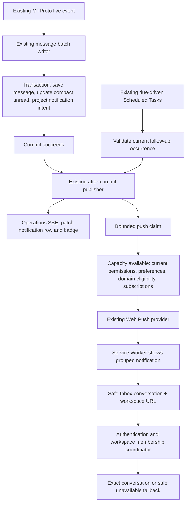

# CRM Notifications & PWA Web Push

Implementation: 2026-10-31. Scope: CRM incoming messages and existing scheduled follow-ups through Operations Notifications. AI Leads has a reserved type and disabled UI control; no discovery, AI calls, Instagram or Support implementation was added.

## Delivery contract

The durable intent is deliberately projected **inside the message transaction**, following the existing architecture. SSE and external push run only after successful commit. A rollback cannot deliver an unsaved message; moving intent creation to a fire-and-forget post-commit callback would add a crash gap. There is no new outbox or runtime. The existing after-commit path is best effort: process termination between commit and publication can leave an intent without an external delivery. This implementation does not claim guaranteed delivery or add unlimited retries.

Projection accepts newly inserted live inbound UNREAD messages only. History, edits, duplicate inserts and outbound messages do not notify. Current conversation/account must be active, connected and CRM-sync enabled, contact unarchived, unread positive, and source message above the explicit read watermark. Priority becomes HIGH when the client replies after an outbound proposal or existing active deal/overdue high-priority task warrants it; no AI classification runs.

The current responsible recipient is selected through the existing contact owner → active sale assignee → workspace owner → permitted viewAny fallback. Base CRM access and own/any visibility apply; an opted-out responsible member does not cause notification rerouting to a colleague. Dispatch rechecks current authorization and domain eligibility. A removed subscription or changed privacy preference while waiting for network capacity must be honored at dispatch. A state change after the last check and after the provider accepted a request cannot revoke that request.

Follow-up uses the existing scheduled notification occurrence, not a periodic task scan. Canceled/completed, rescheduled/snoozed, archived, missing or unauthorized occurrences are rejected. Recipient reassignment is resolved from current ownership. Delivery also checks current occurrence eligibility after waiting for capacity.

## Preferences and API

Existing `webPushEnabled` values are retained. Migration adds:

| Field | Default | Meaning |
| --- | --- | --- |
| `crmNotificationsEnabled` | true | CRM master switch |
| `crmIncomingMessagesEnabled` | false | Explicit opt-in for new incoming in-app notifications and push |
| `crmFollowUpEnabled` | true | Preserve existing follow-up behavior |
| `crmAiLeadsEnabled` | false | Reserved, UI disabled; no producer |
| `crmMessagePreviewEnabled` | false | Permit bounded customer/message preview |

Global Web Push, CRM master and the event switch must all permit an incoming push. Permission alone or a pre-existing global opt-in does not enable new incoming CRM pushes. Private mode uses a generic system notification. When preview is enabled, the stored incoming body is capped at 240 characters; full Telegram text is never copied into a notification log. Turning preview off strips cached list previews and current payload previews, but does not erase the historical bounded body from the database. Enabling preview later cannot reconstruct an old private body.

The existing preferences endpoint accepts a partial boolean patch; the existing web client boolean overload remains compatible. Shared optional new fields permit older cached clients; server responses include defaults. `POST /operations/notifications/push/test` requires current Operations access, configured VAPID, global opt-in and an active own subscription. It uses normal delivery, a per-member/workspace advisory lock and 60-second throttle, one upserted `SYSTEM_TEST` group, and at most five own active devices. Result `delivered` means provider acceptance, not confirmed OS display. The test deliberately does not require CRM opt-in.

Settings uses existing cards/toggles/feedback and EN/RU localization. The browser permission prompt is requested only from the explicit Turn on action. Unsupported, denied, disconnected, subscribed and server-unconfigured states remain visible. Workspace changes abort stale setup and prevent its late preference mutation. Preference mutations invalidate only exact Operations list/unread keys and update the authoritative preference cache; notification events never refetch the entire Inbox.

## Grouping, read reconciliation and suppression

- Stable intent uniqueness is `(workspaceId, recipientMemberId, type, sourceKey)` with source key `account:<accountId>:conversation:<conversationId>`. Conversation identity isolates the same Telegram peer/contact on different connected accounts.
- Upsert compares Telegram sent-at/message identifiers. Equal or older source facts do not reopen the group or reset its push claim. A new message updates one group. The atomic 30-second push cooldown prevents a same-conversation burst from generating a request per message; the next incoming event after the window may send again. No timer sends a trailing push.
- System notifications use the stable group ID as their tag with `renotify: false`. OS/browser behavior can differ; an already delivered system notification cannot reliably be removed on every device.
- An explicit read reconciles the exact conversation group and legacy contact-group remnants. A new incoming message committed while Telegram mark-read is in progress remains unread. Read watermarks never move backwards; concurrent empty→incoming transitions preserve the new intent. Same-batch message+read also reconciles.
- There is no reliable economical per-device proof that a user is looking at one specific conversation. Therefore foreground current chat, another chat and hidden tab use the same delivery rule unless an explicit read/current watermark makes the notification obsolete. Visibility alone never suppresses or marks read. No presence heartbeat or automatic read was introduced.

The Notification Center mounts the existing Operations SSE hook. Known group updates replace/reorder the cached row without blindly increasing the badge. Unknown/partial-list events coalesce a small unread-count refresh at most once per second while visible. In-flight stale badge reads are canceled. Hidden tabs close streams; reconnects have a bounded consecutive-failure budget. CRM and Operations keep their existing separate streams and event contracts.

## PWA setup and navigation

Deploy the schema migration before starting the new API. Generate Prisma/shared artifacts through the normal build. This task generated Prisma locally but did **not** apply a database migration or deploy anything.

Use the existing atomic environment configuration: `WEB_PUSH_VAPID_SUBJECT`, `WEB_PUSH_VAPID_PUBLIC_KEY`, `WEB_PUSH_VAPID_PRIVATE_KEY`. Subject is `mailto:` or HTTPS; keys remain server secrets except the existing public-key endpoint. An all-empty configuration disables push; a partial configuration fails validation. Production requires HTTPS and the existing manifest/service-worker registration.

In Settings → Notifications: explicitly turn on browser/device push, grant browser permission, enable New incoming messages, choose preview privacy and press Test notification. Denied permission must be changed in browser/OS settings; the application does not repeatedly prompt. Subscriptions are user-owned and capped at five active devices; workspace notification preferences are member/workspace scoped.

Incoming targets contain `/ad-sales/inbox?conversationId=…&workspaceId=…&peerId=…`. Service Worker validates same-origin internal targets, focuses an exact existing window when possible, otherwise navigates an existing window or opens one. Navigation failure falls back to opening a window. Expired authentication preserves the internal destination through login. The workspace coordinator validates membership before changing selected workspace and clearing scoped caches, even when the old workspace has no CRM feature. Missing membership/feature/conversation uses the existing safe destination or unavailable UI; no cross-workspace data is shown. The Service Worker does not fetch/cache private messages and does not implement offline sending.

Push can arrive with the page closed on supporting browsers ([MDN Push API](https://developer.mozilla.org/en-US/docs/Web/API/Push_API)). Browser permission requires an explicit user interaction and secure context; runtime capability/permission checks govern availability ([MDN requestPermission](https://developer.mozilla.org/en-US/docs/Web/API/Notification/requestPermission_static)). Desktop/Android browsers exposing Service Worker, PushManager and Notifications can use the flow, subject to OS restrictions. iPhone/iPad require a Home Screen web app on iOS/iPadOS 16.4 or later and a direct user gesture for permission; a normal iOS browser tab is not the installation path ([WebKit](https://webkit.org/blog/13878/)). Provider acceptance does not guarantee display under Focus, battery/network restrictions or OS policy.

## Cost and bounded work

These are source-level operation budgets, **not production latency, Neon billing or Railway savings measurements**. Prisma relation loading may expand a logical include into more SQL statements; member/role size and PostgreSQL plans still matter. Existing CRM message persistence/runtime work is excluded below.

| Path | Additional notification work |
| --- | --- |
| No incoming/due/UI activity | No added poll, presence write, push request, startup task scan or process. Existing scheduled retention/due wake machinery is reused. |
| Duplicate/history/edit/outbound | Projector exits before extra eligibility/recipient reads or intent write when no newly created live inbound applies. |
| Eligible incoming batch | One batched conversation eligibility read; existing recipient snapshot uses contact SHARE lock, contact summary read and workspace member/role/preference read; one SQL group upsert for eligible groups. Empty/opted-out batches skip the write. |
| Post-commit batch (≤100 groups) | One publisher candidate read, one push prepare read plus domain batch eligibility/recipient checks and one atomic conditional claim write. Unchanged/duplicate claims do not send. |
| Network-ready cohort (≤8 slots) | Fresh bounded notification/recipient/subscription read plus registered domain batch checks after capacity becomes available (cohorts contain 1–8 tickets; staggered provider completions can make them smaller). This deliberately adds reads to honor revocations/privacy/read/task changes while queued; it is not a per-device query loop. Cohort count depends on readiness and provider latency. |
| 2–5 devices | Up to 2–5 external requests per eligible group, one per selected active subscription. Cohorts may split device readiness; no acknowledgement polling. |
| 100 messages, one conversation | Per batch one stored group; sequential batches still incur bounded snapshot/upsert work, so do not claim one DB operation for an arbitrarily split burst. Within the cooldown at most one claimed group fanout (≤5 requests); later events after 30s may claim again. |
| 100 distinct conversations | Up to100 groups and500 reserved deliveries; eight concurrent requests, each10s timeout. Queue entries older than30s are skipped, so slow providers may produce fewer deliveries. Ready cohorts add bounded reads as above. No100-channel scan is added. |
| Lost device subscription |404/410 IDs are deactivated by a batched update after the dispatch; remaining sends to those known-stale IDs are skipped. Other provider failures are not retried by a new loop. |
| Follow-up due | Reads only referenced due task IDs/current contacts/members; stale rows deleted in a workspace batch and recipient changes reassigned in one batch. Dispatch-time validation adds active-event reads. No unchanged reminder writes. |
| Preference patch | Current preference read, write only changed flags, then preference/subscription-count response reads. No preference heartbeat. |
| Browser event | Known cached group: no HTTP refetch. Unknown event burst: ≤1 small unread-count read/second/visible client; no Inbox collection refetch. |

Limits:100 groups per publisher chunk,5 devices/member,500 reserved deliveries per API instance,8 global concurrent network requests,30s local queue age,10s request timeout,300s provider TTL. No new retries after failure/queue expiry; a claim may be consumed without a displayed push. A later distinct event outside cooldown can refresh the group. Multi-replica claims are DB guarded; concurrency/reservation limits are per process. Existing in-memory SSE hubs remain process-local, so cross-replica live badge synchronization is not newly guaranteed.

Indexes reused: notification unique workspace/recipient/type/source; recipient list workspace/recipient/createdAt/id; workspace/type/source; workspace/visibilityResourceKey/publishedAt; expiry/id and existing due partial index; preference member/workspace unique; subscription user/active/id and endpoint unique; conversation primary/workspace keys and message conversation/direction/numeric-ID index for bounded read-tail reconciliation. Device `updatedAt` ordering can still sort a user's subscription candidates. No index or planner-performance claim is based on EXPLAIN here.

Storage adds five booleans per preference and two enum values, no table/worker. One current incoming group per recipient/account/conversation plus existing due occurrences; bounded preview only, not an event log. Existing90-day bucketed notification retention applies and reuses scheduled wakeups; preferences and subscriptions retain their existing lifecycle. Railway gains event-driven DB/network work and at most the bounded queue in the existing process; no measured CPU/RAM/network baseline or Neon sleep guarantee is claimed. At100 channels idle work is unchanged; event rate, conversations and device count determine active cost. An open visible browser still performs the existing stream work and can keep its backend active.

## Verification and manual acceptance

Automated suites use mocked Web Push and isolated browser API fixtures; no production-device pushes, Telegram sends or migration execution. See [QA evidence](../qa/crm-notifications/README.md) for exact gate results and changed-file inventory.

Manual iPhone acceptance (requires a staging/test account and explicit own-device consent):

1. Deploy migration/API/web with valid VAPID on HTTPS. Open staging in Safari, Add to Home Screen, launch the installed app and sign in.
2. In Settings, verify incoming is initially off and preview hidden. Turn on device push by tapping its action, grant permission, enable incoming, press Test. Check OS display separately from the provider-accepted status.
3. With PWA closed send a real test Telegram message from another controlled account. Tap push; verify exact account/conversation/workspace and unread. Repeat with PWA foreground in same chat, foreground in another chat, and background; no visibility-only suppression is expected.
4. Send five messages quickly. Verify one updated group/cooldown behavior, then explicit read removes the CRM group. Send another message during mark-read and verify it stays unread. Delivered OS notifications may remain.
5. Enable preview and confirm bounded customer/text preview. Disable it and repeat, including while sends wait on a staging slow-provider fixture; confirm generic content. Disable CRM master/incoming and verify no new delivery.
6. Repeat on a second subscribed device, then deny/revoke permission or remove a subscription. Verify device status/reconnect; expired404/410 subscriptions become inactive after a failed delivery.
7. Test an own-only member, archived/disabled account or conversation, and inaccessible workspace. Sign out before tapping an old push; login must restore an authorized target or safe fallback without showing old workspace data.
8. Schedule a near-term follow-up; reschedule/snooze/complete/archive before due and while queued. Only the still-current eligible occurrence should dispatch. AI Leads remains unavailable.

Real iPhone/Android OS display, Focus behavior, multiple physical devices and provider failure injection remain manual; the local automated browser is not evidence of those behaviors.

## Rollout and rollback

Roll out migration → API/shared → web/service worker. Keep incoming default off; each user enables it explicitly. First verify with controlled staging devices and the explicit test action. No production push was sent by this implementation task.

Immediate rollback is to disable incoming or CRM master for the affected workspace/member, or global Web Push to stop all pushes for that member; clearing the VAPID trio disables server push deployment-wide after restart. Already accepted pushes cannot be recalled. Revert API/web code together if needed, retaining additive columns/enums and existing settings data; do not destructively down-migrate enum values/notification rows during rollback. Stored previews follow normal90-day retention; turning a preference off is not a data-erasure operation.
