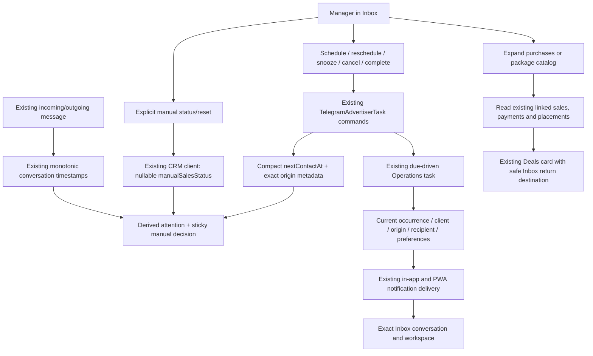

# CRM Sales Workflow, Follow-up & Package Sales

Implemented 2026-10-31, extending the existing Telegram CRM/Inbox. No separate CRM, AI call, Lead Discovery, Instagram runtime, Bot Support, price engine or finance write was introduced.

## End-to-end workflow

Message facts determine attention; reading a message does not mean answering it. Status changes never modify financial records, sale lifecycle, contact stage or conversation visibility. Current purchases, messages and catalog remain in their existing stores.

## Status semantics

| Status | Source / transition |
| --- | --- |
| NEEDS_REPLY | Active conversation's last inbound is later than outbound, or no outbound exists; independent of unread count |
| WAITING_FOR_CLIENT | Latest outbound is at least as recent as inbound; a newer client reply changes derived attention to NEEDS_REPLY |
| FOLLOW_UP_DUE | Effective next contact time has arrived, before normal timestamp attention |
| INTERESTED | Explicit sticky manager decision |
| CLOSED | Explicit sticky manager decision; new traffic never clears it |
| DO_NOT_CONTACT | Explicit sticky manager decision; commercial eligibility false and all CRM manual sends blocked until explicitly cleared |
| HUMAN_REVIEW | Explicit sticky manager decision; no automatic decision or send is implemented |

Only the four manual decisions are persisted, in nullable `TelegramAdvertiser.manualSalesStatus`. Selecting Automatic clears that decision and resumes timestamp/due derivation. NEEDS_REPLY/WAITING/FOLLOW_UP are not editable stored flags; there is no automatic status history table, event-time status write or AI classifier. Manual decisions apply to the client across linked account conversations; timestamp attention is still exact-conversation based.

Inactive IGNORED/ARCHIVED conversations and archived clients have no active sales attention. Their stored decision remains available, and neither a new message nor clearing a manual decision changes conversation state. Manual decision takes label precedence over due attention; the Follow-up filter independently includes overdue INTERESTED/HUMAN_REVIEW clients and excludes CLOSED/DNC/inactive clients. NEEDS_REPLY filter follows the automatic attention policy; Unread is a separate message-count filter. All clients remain accessible in their appropriate existing Inbox view, including terminal business decisions on otherwise ACTIVE conversations.

`deriveCrmSalesAttention` is the pure dependency-free shared policy used by API projections and realtime cache patches. Manual sending now updates conversation/client timestamps with monotonic SQL so a late outbound commit cannot overwrite newer incoming activity. Equal timestamps use the existing outbound-wins convention; this is not an inferred semantic ordering of two messages sent within the same Telegram timestamp resolution.

DNC is conservatively enforced for **all** current CRM manual messages because the existing send endpoint does not classify message intent. A manager must explicitly clear it before replying as well as before outreach. The ready-send guard re-reads the current conversation/contact and ownership after waiting for the Telegram handle, including unlinked→DNC and contact-relink cases. There is no transaction held over a Telegram request. A restriction changed after the final check cannot recall a request already submitted to Telegram.

Merging clients preserves DNC if either client has it; otherwise the target manual decision wins, falling back to the source if unset. A merge does not silently restore commercial contact permission. `commercialOutreachAllowed` is a contact/conversation eligibility fact, not authorization for a future AI agent to send automatically. Any future producer still needs its own permissions, approval and policy checks.

## Follow-up lifecycle

Inbox controls reuse `TelegramAdSalesCrmTasksService` and `TelegramAdvertiserTask`, not a new reminder entity. Schedule creates a FOLLOW_UP with the originating conversation in existing metadata. An identical open Inbox occurrence can be recognized without another task/audit write. The owner defaults to the client's current owner, otherwise the acting member.

- Schedule accepts date/time and optional title.
- Reschedule changes due time and clears prior reminder/snooze overrides.
- Snooze changes the effective occurrence using `snoozedUntil ?? remindAt ?? dueAt`.
- Cancel and Complete terminate the open occurrence. Repeated commands and unchanged patches avoid business/audit/notification writes.
- Current reminder and overdue state appear in client details; quick actions use the thread menu, desktop context menu/Shift+F10 and the mobile touch menu.
- Scheduling/rescheduling is unavailable for inactive/archived, CLOSED or DNC clients. Existing reminders can still be completed/canceled. Canonical commands recheck current viewing/editing ownership under the contact lock; foreign member, sale, placement or origin links are rejected.

The compact `nextContactAt` changes only when its effective value changes. The next open reminder uses a bounded ordered query over effective time; existing manually entered legacy next-contact dates can still be displayed when there is no task. Those legacy dates alone do not invent a scheduled notification.

A changed task replaces its pending occurrence and dismisses obsolete published reminder groups transactionally, then invalidates affected Operations recipients after commit. Deletion results aggregate distinct recipients, not every historical occurrence. Due and network-ready delivery share current occurrence validation, including completed/canceled/snoozed/archive/DNC/CLOSED conditions and the exact originating conversation/account. Original origin metadata is preserved even when a display URL must fall back, preventing a moved/archived conversation from bypassing the policy.

Inbox-origin reminders target the exact conversation/workspace; legacy reminders with no proven origin retain a truthful client route. Expired authentication and inaccessible targets use the existing notification navigation coordinator. Already delivered OS notifications cannot be reliably recalled. Follow-up never sends a Telegram message automatically, and no new timer, cron, scan or worker was added.

## Server contracts

Serializable contracts live in `packages/shared/src/types/telegram-crm-sales-workflow.ts`.

| API | Result |
| --- | --- |
| GET `/telegram-crm/conversations/:id/sales-workflow` | Exact conversation/client state, manual/derived status, authoritative `canEdit`, next reminder/legacy date and commercial eligibility |
| PATCH same route | `{manualStatus: null or one of four manual decisions}`; authoritative workflow response |
| POST `/telegram-crm/conversations/:id/follow-up` | `{at: ISO, title?}`; authoritative workflow response |
| PATCH `/telegram-crm/conversations/:id/follow-up/:taskId` | `{action: RESCHEDULE/SNOOZE/CANCEL/COMPLETE, at?}`; authoritative workflow response |
| GET `/telegram-crm/contacts/:id/purchases?cursor&limit` | Compact linked-sale cursor page; initial-page aggregate summary |
| GET `/telegram-crm/package-sales-context?cursor&limit` | Read-only existing product page plus bounded current network composition and restrictions |

All endpoints use authenticated workspace context. Read-own and edit-own scope are checked independently. Purchase history additionally requires Sales view permission and follows the existing Deals assignment restriction (`sales.editOwn` without `editAny`). Catalog requires CRM visibility and Sales view. Controllers contain no Prisma logic; the canonical task provider is composed/exported once from CRM and consumed by the existing Sales host without a circular module import or second implementation.

Live workflow/conversation, purchases and package context reads bypass the generic HTTP response cache. TanStack Query remains the client deduplication layer; no browser-side cache replaces authorization.

## Purchases, package sales and historical truth

The initial purchase page returns purchase/deal count, latest proven purchase and separate received/agreed amount groups. Purchase means a non-DRAFT/non-CANCELLED linked sale with a positive nonvoid payment or COMPLETED status. `lastPurchaseAt` is that qualifying sale's creation timestamp, not a fabricated invoice/payment date. Deal history can also contain drafts/canceled records, labeled with their actual status.

Received totals use actual nonvoid `payment.currency`; agreed totals use actual placement currency, with DRAFT/CANCELLED quotes excluded from the aggregate agreed summary. Per-sale page amounts remain the actual recorded amounts. Decimal aggregation stays in SQL/Prisma Decimal; currencies are never added together, converted or relabeled with settlement currency. These are read projections, not new financial rules or updates.

Only `advertiserId` proves attribution. Unlinked legacy username/anonymous matches are not silently counted: the contract says `LINKED_SALES_ONLY`, and the UI explains incomplete historical coverage. Missing placements/product/network references are explicit. Product/network names are current display labels for saved IDs, not immutable historical commercial snapshots. Saved placement channel composition and agreed price/currency are shown; current network membership is not used to invent a historical package.

History uses keyset `(createdAt,id)` with default20/max50 sales and up to100 displayed placements per sale. The UI can load subsequent sales; `hasMorePlacements` directs users to the existing deal card for a large placement set. Currency aggregate results have explicit caps/overflow errors instead of silently truncated totals. Initial aggregates return bounded results without loading all sale rows into Node; PostgreSQL still processes relevant history, so large-history SQL cost is not constant-time.

Package Sales Context reads existing active products on eligible managed channels and current networks. It returns stored nullable fixed price/default CPM/minimum, currency, duration/permanence, channel placement limits, `asOf` and product/network update timestamps. CPM is a rate, not a calculated flat package total; missing/nonfixed prices require a quote. Networks have no canonical flat package price. No default-product materializer, historical price calculation, live slot availability check or price engine runs here. A later booking must still use existing quotation/inventory validation.

Discount policy is `MANAGER_APPROVAL_REQUIRED`; minimum price is not a newly authorized discount. Product pages default20/max50, networks cap50 and channels/network cap100, with explicit truncation flags. Product cursor pagination can grow without fetching all catalog entries; the bounded network overview deliberately reports its limit. Future Copilot receives these contracts plus existing bounded message-history APIs and contact/notes endpoints; no new AI customer database or copied Telegram history was added.

## Inbox UX and cache behavior

The existing Telegram-like list/thread/details layout remains. Desktop details open by click and narrow the thread; mobile details use the existing fullscreen native dialog. The client panel contains contacts, sales status, follow-up, lazy purchases, lazy available packages, existing notes, source and an honest reserved AI section. Instagram is shown only if a contact method is already recorded; no Instagram API/integration was added.

Purchase links open the existing Deals route with a validated same-Inbox return destination, retaining conversation/workspace/details. Generic Shared Chat UI adds only an optional context-menu callback; no client, sale, reminder, permission or CRM import enters `components/chat`.

Workflow queries are deduplicated between thread and details. Authoritative mutation responses patch the exact workflow/client Inbox rows, reminder date and filtered membership. Known `contact.updated` facts patch cached rows; only affected mounted workflow keys refetch. Reconnect reconciles active workflows as well as existing list/history behavior. Purchases/catalog are not refetched for a status change. Existing central Deals mutation reconciliation invalidates exact purchase keys for the old/new linked client (including payment/placement refresh and delete), so returning from a modified deal does not reuse a fresh-looking stale summary. Older Clients task UI now uses the canonical task key, so an open related task surface can reconcile narrowly. No whole Inbox refetch per known message or status event was added.

Native-dialog mobile QA exposed existing portal controls falling behind the top layer. A neutral overlay-host/context helper routes shared select/date/modal portals into their owning app modal or native dialog when appropriate, otherwise the document body. A shared reference-counted body lock also restores scrolling when the whole drawer unmounts with a child form open. This shared fix contains no CRM business rule and adds no network/runtime work. Keyboard navigation, Escape, focus restoration, drawers and compact menus are verified in the QA evidence. Physical phone keyboard behavior remains manual acceptance.

## Cost and runtime work

Source-level budgets below exclude auth/membership resolution, Prisma relation-loading expansion, scheduler wake recomputation and the existing message/runtime work. They are **not measured Neon charges, EXPLAIN plans, latency reductions or Railway savings**.

| Action | Added/retained useful work |
| --- | --- |
| Idle /100 channels | Zero new poll, DB query/write, AI/Telegram request, MTProto session, timer or worker. Existing runtime leases/streams and due scheduler remain. |
| Inbox list | Existing one bounded logical conversation query; new contact decision fields and derived attention add no purchase query or status write. |
| Select conversation/workflow | One scoped conversation read plus one LIMIT1 current-reminder read for a linked client, plus permission checks. The shared query key deduplicates thread/details. |
| Open details | Existing conversation/contact reads remain; existing contact detail has four logical reads. Purchase history/catalog stay unmounted until expanded. |
| Initial purchase page | Four bounded-result data operations (sale page, page currency aggregate, summary stats, summary currency aggregate), plus CRM contact preflight; subsequent page two plus preflight. Snapshot transaction keeps page/summary consistent. |
| Package context page | Two bounded logical reads: products/constraints and network composition. Network summaries repeat on subsequent product pages; no materialization or writes. |
| Status change | Scoped conversation read, contact lock and current scoped contact read; one update and one meaningful activity only if changed. Then authoritative workflow response (two reads) and existing SSE event. No-op skips update/activity/event. |
| Schedule | Approximately12 explicit useful-action reads and5 mutating SQL statements including no-match cleanup and conditional compact update; identical schedule approximately6 reads/0 writes. Then workflow response reads. |
| Reschedule/snooze | Approximately15 reads/5 mutating statements; unchanged schedule skips writes/wake. |
| Cancel/complete | Approximately8 reads; cancel4 mutating statements, complete5 including meaningful activity. Repeated cancel approximately2 reads/0 writes; repeated complete approximately6 reads/0 writes. Then workflow response reads. |
| Manual message | Current conversation/contact guard before actual send and monotonic compact writes replace unsafe assignment. Existing Telegram send/idempotency path is retained, not duplicated. |
| Realtime | Known entity patches avoid list refetch; small scoped workflow reconciliation only for mounted affected conversations/reconnect. No new HTTP request per row or periodic refetch. |

Mutation counts distinguish SQL statements from affected rows: conditional compact updates and canceled-pending cleanup can affect zero rows. Useful-action validation/locking favors correctness over fewer reads; it does not run for every incoming message. Task scope sorts effective open occurrences through a new partial expression index. The sale cursor replaces the shorter prefix index with `(workspaceId,advertiserId,createdAt,id)`. Existing workspace/contact, placement-sale, payment-sale, product/channel and network membership indexes are reused. Relation predicates/aggregates still require staging EXPLAIN for measured large-history performance.

Storage adds one nullable enum field per client and two indexes (one replaces an older index), not per-message status/history records. Manual decisions produce one existing meaningful activity only when changed. Existing task/activity business-history retention is unchanged; no new append-only table was created. Existing Operations90-day notification retention continues. Railway runs the same process/connections, with bounded active HTTP/SQL work and no new persistent RAM/CPU loop. Neon sleep behavior is unchanged by idle workflow features; existing open runtime/streams can still prevent complete sleep.

## Deployment, rollback and acceptance

Migration: `20261031110000_crm_sales_workflow` adds the nullable manual enum/column, replaces the sale-history prefix index and adds the SQL-owned partial effective-reminder expression index. No backfill invents manual decisions or rewrites legacy next-contact dates. Prisma cannot express the latter index directly; its schema comment references the migration. Client generation/builds are local; **production migrations were not applied**. Existing notification migration from Prompt3 is also a deployment prerequisite if not already applied.

Apply migrations through the normal reviewed deployment procedure before starting the new API, then deploy API/shared and web together. Index creation is regular PostgreSQL CREATE INDEX, so assess lock duration on a large staging copy before production. No new environment variable, service or external credential is required for this step.

Rollback API/web together while keeping additive manual data and indexes. Do not drop DNC data or blindly deploy an old sender that ignores it: disable CRM manual sending at account configuration until guard-aware code is restored. Already sent Telegram messages/system notifications cannot be recalled. Follow-up tasks, sales/payments and existing contacts remain canonical and must not be deleted for rollback.

Manual acceptance:

1. With a test workspace/client, verify inbound→Needs reply, explicit read leaves Needs reply, outbound→Waiting and a newer inbound→Needs reply. Reverse mock arrival order and verify last activity never regresses.
2. Set each manual decision, send controlled mock/new inbound and verify it remains. CLOSED/DNC never reopen from traffic; Automatic explicitly clears. DNC disables sending until cleared. Verify own-only access and another-workspace IDs fail server-side.
3. Schedule, reschedule, snooze, cancel and complete from Inbox. Repeat commands, verify one current occurrence/no duplicate audit writes, overdue view includes INTERESTED/HUMAN_REVIEW, and stale published reminders disappear in-app. No follow-up message is automatically sent.
4. Open a reminder notification to exact conversation/workspace; archive/relink before delivery and verify current-origin rejection. Complete/cancel legacy reminders whose old origin no longer exists.
5. Expand purchases with multiple placements, currencies, missing legacy data and more than one cursor page. Check current deal link and exact Inbox return. Confirm no all-history request occurs when opening the list.
6. Expand package context: existing product rates, actual current network channels, unknown price/constraints and manager-approved discounts. Verify no default products are created and no quote/slot promise is fabricated.
7. Test desktop1024/1440 and mobile320/390: right panel/fullscreen drawer, touch menu, right-click/Shift+F10, status selector, date/time picker, Escape/focus restoration and keyboard-sized viewport. Real iPhone keyboard/OS/PWA display is a physical-device check.
8. Hide/reopen the tab while another manager changes state; active workflow/list reconcile, with no hidden polling or idle write.

See [QA results/screenshots](../qa/crm-sales-workflow/README.md) and the scoped changed-file inventory there. Existing repository-wide failures and concurrent outside-slice changes are reported separately; no claim that the whole monorepo is green is made.
