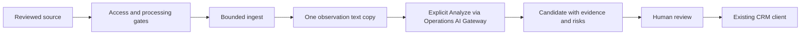

# Telegram Lead Discovery — implementation and rollout

Status: implemented locally for Prompt №7; disabled by default. This is not a production-readiness declaration. Schema deployment, real database concurrency/query plans, approved Telegram access and configured provider integration require staging acceptance. No production migration, live collection, paid AI call or commercial message was executed during this work.

## Product boundary and flow

Lead Discovery is a Growth CRM use case under `telegram-crm/lead-discovery`, not Growth campaign Advertising Sources or our publishing inventory. Sources identify where permitted advertiser evidence came from; `TelegramAdvertiser` remains the sole CRM client record. Source/catalog presence does not grant processing permission.



Sources, feed and review queue live at `/ad-sales/leads`. Inbox AI Leads renders the same real candidate queue without creating a Telegram conversation. A candidate has no peer/thread and cannot be sent a message through this module. CRM linking does not send, start a conversation or bypass existing DNC rules. Deep qualification and personalized outreach remain outside this stage.

The main integrator fixed the shared API contract first. Grace/Knuth/Parnas read-only preflight, non-overlapping backend/frontend implementation and Turing integration review were used. Related shared Select accessibility defects were fixed in one primitive, with consumer regression coverage; no consumer product behavior was refactored.

## Data and identity

The migration adds exactly three tables:

- `TelegramLeadSource`: workspace/source key, immutable resolved channel ID, metadata, existing account reference, reviewed processing reference, own-channel override, monitoring owner/state, checkpoints and coverage/error facts.
- `TelegramLeadObservation`: unique workspace/source/external-message identity, one bounded text copy, literal links, content hash, publication/observation/edit timestamps, original availability, classification/extraction versions/results, existing AI operation references and 90-day expiry. A newly captured changed content hash renews that bounded retention window; duplicates, URL-only changes and deletion do not.
- `TelegramLeadCandidate`: compact normalized identities, roles, human confirmations, risk/review state, bounded history, revision, CRM link, merge alias and all associated source IDs. It contains no duplicate full post text.

Composite workspace FKs enforce source, candidate, account and CRM references. Workspace/channel ID is unique independently of account, so the same channel cannot be added twice through different accounts. Names and similar ad copy are never identity keys. Source keys are `telegram:username:<lower>`, `telegram:id:<positive-id>` or `manual:<lower-label>`.

Candidates deduplicate only on strong exact normalized public business identities. Destination links and agencies do not establish advertiser ownership. Human merges preserve prior identity aliases for future observations, cap material moves at 5,000 and reject cycles/ambiguous or conflicting client links. Source IDs survive raw evidence expiry. Review uses optimistic revisions; rejection and DNC are not silently cleared by new evidence. CRM account removal clears its source reference and marks access lost; existing CRM client merges transfer compact acquisition references transactionally.

No session strings, access hashes or provider secrets appear in API source records. Telegram access hashes exist only in the already-owned handle's bounded in-memory cache. No media downloads or screenshots are ingested. UI QA screenshots contain synthetic fixture data.

## Authorization and processing gates

Permissions: `adSales.leads.view`, `adSales.leads.manage`, `adSales.leads.review`, `adSales.leads.analyze`. AI also requires `operations.executeAi`; existing gateway budget/model/accounting permissions remain authoritative. Account/channel catalogs require manage access because they may reveal private metadata. Requests and mutations remain workspace-scoped; monitoring runs using a fresh scoped context for the recorded owner.

`INTERNAL_LEAD_DISCOVERY_ENABLED` must equal `true`. Otherwise no monitoring registry read or channel subscription is installed. Processing also needs a deployment-reviewed `INTERNAL_LEAD_DISCOVERY_GRANTS` JSON array, default deny, limited to 1,000 records and 512 KiB globally. A free-form UI reference alone grants nothing. Example (replace placeholders and expiry after review):

```json
[
  {
    "workspaceId": "reviewed-workspace-id",
    "sourceKey": "telegram:username:approved_channel",
    "channelId": "123456789",
    "accountId": "existing-account-id",
    "reference": "policy:reviewed-source",
    "ingest": true,
    "ai": true,
    "allowOwnChannel": false,
    "expiresAt": "2026-12-01T00:00:00Z"
  },
  {
    "workspaceId": "reviewed-workspace-id",
    "sourceKey": "manual:approved-materials",
    "channelId": null,
    "accountId": null,
    "reference": "consent:reviewed-materials",
    "ingest": true,
    "ai": false,
    "expiresAt": "2026-12-01T00:00:00Z"
  }
]
```

Every value must match source/workspace/account/channel/reference. A username-only grant cannot authorize an unknown channel for capture or AI. Limited metadata resolution can precede binding, followed by the strict immutable-ID grant check. Expiry, access, ownership and current authorization are rechecked before processing and paid stages. Own publishing channels are excluded from the chooser and require an explicit override plus a reviewed own-channel grant. Revoked authorization or grants pause and evict monitored sources instead of failing on every later post. Configuration changes require deployment refresh; no grant synchronization poll is introduced.

## API contract

Base: `/telegram-crm/lead-discovery`. DTOs and response types are exported from `packages/shared/src/types/telegram-lead-discovery*.ts`. Collections use compact explicit selects and cursor pages; errors retain actionable gate/limit codes.

| Method / path | Purpose and bound |
| --- | --- |
| GET `config`, GET `accounts` | Availability/capabilities; manage-only account catalog |
| GET `accounts/:id/channels` | Existing-dialog cursor page, max100 |
| GET/POST `sources`, PATCH `sources/:id` | Workspace registry and reviewed state/configuration |
| POST `sources/import/preview`, `sources/import` | Text/CSV preview and bounded idempotent commit |
| POST `sources/:id/validate` | Explicit technical access and immutable-ID validation |
| POST `sources/:id/scan` | Explicit history page, max50, optional `beforeId` |
| POST `sources/:id/recover` | One bounded checkpoint difference |
| POST `sources/:id/materials` | Up to20 already-permitted materials |
| GET `feed` | Filtered observation cursor page |
| POST `analyze` | Up to5 explicitly selected observation IDs |
| PATCH `observations/:id/review` | Human material decision |
| POST `observations/:id/candidate` | Human fallback candidate from evidence |
| GET `candidates`, GET `candidates/:id` | Review queue and details |
| PATCH `candidates/:id/review`, POST `candidates/review` | Revision-bound single/bulk review, max20 |
| GET `sources/export` | `format=csv|xlsx`; up to1000 rows, base64 file and truncation flag |

## Capture and recovery

Manual source import supports text and header-aware quoted CSV, up to 64 KiB / 100 entries, preview before commit, idempotent creation, and clear row errors. It never joins a channel. `APPROVED_EXTERNAL_SOURCE` is reserved in contracts and unavailable for creation. Manual permitted materials use the same normalization/identity pipeline, up to 20 per request.

Private Telegram invitation URLs may be registered as paused sources. Exact `t.me`/`telegram.me` invite forms canonicalize to one SHA-256-based source key; the URL is retained in the authorized workspace registry, never in the identity key. Access validation reuses the existing live account and read-only `CheckChatInvite`; only `ChatInviteAlready` permits resolution. Unjoined, malformed and inaccessible invitations never trigger an automatic join. Source titles remain user-owned, so topic labels survive Telegram metadata validation.

Telegram capture attaches one channel listener to each already-live CRM account handle. It never opens a fallback client, second runtime or per-source handle. Existing CRM private-message processing remains separate. Catalog requests page existing dialogs, filter broadcast channels and exclude own channels. Signed-in account subscription is only technical access, not processing approval.

The shared reader uses Telegram's existing [updates model](https://core.telegram.org/api/updates), bounded [channel differences](https://core.telegram.org/method/updates.getChannelDifference) and [dialog listing](https://core.telegram.org/method/messages.getDialogs). It performs no joins, access bypass or media fetch. History is at most 50 posts per explicit scan, differences at most 100 per pass. Too-long/partial results remain gaps; deleted text cannot be restored when Telegram no longer supplies it.

Cold StringSession entity caches are handled with a bounded peer cache (1,000), strict-ID public username hints, or one shared 100-dialog warmup for private channels. Channels outside that page require explicit catalog paging; this is not automatic exhaustive discovery. Known-ID metadata validation itself uses the SDK entity cache: after a cold restart, open the connected account catalog first to warm a paused source before revalidation. Until then, a metadata lookup can report unavailable despite a still-valid reviewed source. The history/recovery hint fallback does not imply automatic exhaustive metadata repair. Public username reassignment never retargets a stored source ID. Dialog cursors are random, in-memory, max 32 / five-minute expiry and reveal no access hashes.

Reader concurrency is two actual requests per account and eight per process, with a 15-second response deadline and no new product-level queue/retry. The existing SDK request retry policy remains unchanged. A timed-out SDK request retains capacity until actual settlement because closing the shared client would disrupt CRM. There is no claim of hard network cancellation.

The monitor caches at most 10,000 active sources process-wide; workspace registry limit is 1,000. Queues cap at 1,000 source/message identities, coalesce events and drain at most 100 per batch after a nonempty-only 50 ms delay. It rejects older queued versions, records uncertainty for overflow/coalesced intermediate versions and uses the common workspace advisory lock for ingest and coverage changes. Recovery automatically attempts at most two accounts concurrently and 20 sources per account/pass. Excess sources remain gapped until explicit recovery. No infinite retries or startup history sweep is added.

Source origin/account/reference and checkpoint freshness are checked under the lock before persisting RPC results. Stale history/recovery/live versions cannot overwrite newer edits/deletes or prove coverage for a newly configured source. Coverage gap writes recheck their in-memory generation after acquiring the lock and include a DB proof-time predicate to avoid downgrading a later committed recovery.

Source row locks are acquired in sorted order before the locked eligibility reread; source PATCH/validation updates cannot interleave between that gate and material writes. No Telegram/provider request occurs inside the transaction.

The workspace UTC-day quota is 10,000 new posts. Once a monitored batch reaches it, that process mutes further capture for the workspace until the next UTC day, lazily on a future event, marks coverage gapped and removes queued items. There is no wake timer. Explicit endpoints still enforce the durable quota; process restarts may perform another bounded rejection before muting.

## Analysis and human review

Opening any list, ingesting, scanning or reconnecting never invokes AI. Analyze explicitly selects up to five observations, processed sequentially via the existing Operations gateway:

1. `LEAD_AD_CLASSIFICATION`, schema `lead_ad_classification_discovery_v1`, prompt version `lead-discovery-v1`.
2. For suitable advertisements, `LEAD_CONTACT_EXTRACTION`, schema `lead_contact_extraction_discovery_v1`, same prompt version.

Both pass existing budget admission, idempotency, configured model selection, strict structured validation, token/cost accounting and UNKNOWN handling. They reuse the existing AI ledger; there is no second billing store. Versioned claims are persisted before calls; unchanged current-version material is reused while its observation is retained. After the 90-day evidence window, an explicitly reimported old material is a new retained observation and can require a new reviewed analysis; there is no permanent raw-message tombstone ledger. Uncertain usage/timeout cannot silently trigger paid retries. Receipt read models show the existing operation even after an interrupted result-persistence step. `LEAD_QUALIFICATION` remains reserved, qualified-lead metrics remain zero.

Classification returns `ADVERTISEMENT`, `MUTUAL_PROMOTION`, `ORGANIC_CONTENT` or `UNKNOWN`, commercial intent, niche, offer type, has-contact, relevance, confidence, bounded risks and literal evidence. It never asserts payment. Strict schema has nine fields, at most ten risks and twelve evidence fragments. Deterministic prefilters reject empty/nontext/oversized noise, not merely posts lacking the word “advertisement”.

Extraction returns project/product names, at most twelve contacts with type, role and literal evidence, plus warnings. Supported types: Telegram, Instagram, website, public business email/phone. Names/contact evidence must occur in the permitted text; invented identities are rejected. Channel/destination references without explicit contact instructions are treated as destinations, not advertiser contacts. Instagram accepts profile references only; there is no Instagram Direct integration, website crawling or external-page fetch. Model output cannot set human confirmation.

Managers see original evidence, AI reasons, all source summaries, risks, existing costs and review history. Risk labels (`SUSPICIOUS`, `NEEDS_REVIEW`, `REJECTED`, `ACCEPTABLE`) are review signals, not fraud verdicts. Explicit contact confirmations and acceptable review are required for CRM linking/creation. Exact existing identities, ambiguity, archived clients and DNC are checked before linking. Creating a CRM client uses existing `TelegramAdvertiser`/contact records, never a synthetic peer or conversation. Bulk review is capped at 20. All human changes remain revision-bound.

## Analytics and export

Source pages display observed posts, classified ads, unique candidates, confirmed contacts/leads, rejected candidates/materials, effective latest ad time, coverage, errors and priority. Counts concern retained observations and compact associated candidate records; they are not lifetime raw-post totals. Source IDs remain after evidence expiry but expired post text/classification is not fabricated. Qualified leads are explicitly zero until Prompt №8.

`NO_ADS_30D` requires proven continuous coverage of at least 30 days, fresh coverage end (five minutes), no recent advertisements and no unresolved/UNKNOWN/failed material in the interval. Source age or one historical scan proves nothing. Recent edits of older posts count as recent content changes; loss of intermediate text versions resets proof. Coverage gaps, startup/reconnect, queue overflow, access changes and stale checkpoints block absence claims. Quiet channels may need explicit recovery to refresh proof; there is no heartbeat DB write. `LOW_YIELD` and priority are simple evidence-based signals; insufficient evidence remains explicit. Nothing auto-disables sources based on classifier output.

Status/search filtering happens before cursor pagination. Feed cursors use observed time plus ID. Original availability is “observed as of capture”, not a fresh check on list open. Known deletion/access or identity loss suppresses unsafe original links; a retained copy is never represented as a currently fetched original. The system cannot discover deletions while offline without recoverable events.

CSV and XLSX export up to 1,000 sources and metrics, reuse existing ExcelJS and return bounded base64 download payloads. Cells starting with whitespace/control plus formula prefixes are escaped. No provider call or browser evidence persistence occurs during export.

## Runtime and SQL cost assessment

These are source-level bounds, not measured Neon bills, RSS, latency or Telegram/provider throughput. Data-call counts exclude transaction protocol and authorization graph loads. The existing live CRM account lease still renews about every 30 seconds (~2,880/day for the one shared runtime lease, not per account); this inherited cost is not attributed as zero idle cost.

Discovery adds no recurring DB poll, cron, worker, deployment, handle or idle AI call. Startup performs one bounded active-source read and meaningful proof invalidation; source changes/reconnects trigger bounded work. Per-event source filtering scans the bounded cache, so CPU is O(cached sources × arriving events), although idle source count creates no linear DB work.

| Active sources | Idle Discovery periodic reads/writes | New 100-post full batch (one workspace/owner) | Maximum rows changed including source checkpoints |
| --- | --- | --- | --- |
| 10 | 0 | 8 data calls for Telegram, 7 manual | 110 |
| 50 | 0 | 8 / 7 | 150 |
| 100 | 0 | 8 / 7 | 200 |
| 1,000 | 0 | 8 / 7 | 200 |

The Telegram batch includes one owned-channel catalog check and one compact sorted source-row lock before the eligibility reread; no query is performed per post/source. Already-checkpointed live duplicates use four calls (three for manual sources) and no material read/write. An unchanged-content batch with a newer pts adds the bounded hash read and writes only a changed checkpoint. Changed checkpoints write only changed sources. Sparse traffic and different monitoring owners fragment batches: do not assume every 100 posts combine into one transaction. A source list uses two data calls (three when derived filtering is needed); export uses two. Analytics still scales with retained evidence: derived filtering can aggregate up to 900,000 observations/workspace at the configured maximum, so staging `EXPLAIN (ANALYZE, BUFFERS)` is required. Contact expansion occurs once per distinct source/candidate, not per observation.

AI is more expensive than ingest. The audited two-stage/new-candidate path is approximately 62 data calls / 29 mutations per post, plus one initial observation batch read per five requested posts, four forced authorization-graph refreshes per post and up to ten alias reads. This includes existing gateway admission/accounting work; it must not be called “one SQL per AI result”. Final safety rechecks may add bounded constant reads. Each stage performs token-count and generation provider requests.

| New posts/day | Fully batched ingest data calls, Telegram | If all get both AI stages | Approximate AI data calls | Approximate AI mutations | Provider requests |
| --- | --- | --- | --- | --- | --- |
| 0 | 0 recurring | 0 | 0 | 0 | 0 |
| 100 | 8 | 200 operations | 6,220 | 2,900 | 400 |
| 1,000 | 80 | 2,000 operations | 62,200 | 29,000 | 4,000 |
| 10,000 | 800 | 20,000 operations | 622,000 | 290,000 | 40,000 |

AI calls are never implied by these post counts: the real default is manual selection and zero calls. Budgets and deployment model settings constrain actual spend. No prices/models were hardcoded for this stage.

Raw observation retention is 90 days. Cleanup extends existing daily `operational_history.cleanup` by two bounded deletes, each max 20,000 rows globally with `SKIP LOCKED`. No per-row cleanup loop or new timer is added. Linked compact acquisition candidates/aliases are retained; expired unlinked candidates with no remaining observations can be removed. Existing AI operation reconciliation/retention remains authoritative and is not refunded/deleted by evidence cleanup.

At 10,000 new posts/day with no older content-version renewals, a 90-day window holds about 900,000 raw observations; 4,096 UTF-16 characters / 16 KiB material cap gives a conservative ~14 GB raw-text estimate before indexes/JSON/row overhead. This is not a hard storage ceiling: genuine edits renew the current permitted version, and the new-post quota does not cap edits of existing rows. Repeated broad historical edits can retain a larger active set; staging must measure that pattern and set aggregate storage/change admission before wider rollout. The observation cleanup cap has 2× headroom at that arrival rate. Existing AI cleanup is 20,000 operations/day: two stages on every post consume all capacity, leaving no headroom for Copilot or other workspaces. Ten workspaces at that sustained maximum imply 100,000 observations and 200,000 AI operations/day: expiry backlog grows by roughly 80,000 and 180,000 rows/day respectively. This deployment is a bounded pilot, not an accepted sustained SaaS maximum. Aggregate admission quotas/retention capacity and real query plans must be reviewed before that load. Global grants also cap at 1,000, below the monitor's defensive 10,000-source cache limit.

## Migration, rollout and rollback

1. Preserve and deploy prerequisite CRM/AI migrations from earlier stages in order; inspect schema drift on staging. This worktree includes previous stages and unrelated uncommitted changes.
2. Review `apps/api/prisma/migrations/20261101010000_telegram_lead_discovery/migration.sql`: only three new tables, their indexes/FKs and a positive candidate revision check. It has no backfill or external work. Prisma validate/generate do not apply it.
3. Apply to staging under normal release controls; verify composite workspace FKs, unique identity races, source patch/RPC ordering, expiry cleanup and actual query plans with two concurrent DB connections.
4. Deploy with flag false and empty grants. Check existing CRM/notifications/Copilot paths independently. API build currently has five pre-existing errors outside this stage; resolve through their owning work before claiming a green deployment.
5. Configure a small reviewed grant cohort and existing AI model/tariff/budget settings. Enable the flag, validate one approved source, manually ingest synthetic/permitted material, explicitly analyze, review and link an existing client. Check ledger/UNKNOWN states and absence of sends/joins.
6. Expand only after physical/staging access, coverage, cost and retention acceptance. Do not enable a workspace-wide historical sweep or automatic AI.

Rollback first sets the flag false and removes grants, then restarts the process to detach listeners and clear caches. Stop access before DB reversal. Prefer retaining additive tables for audit and forward repair. If data deletion is separately approved, export required compact acquisition records, drop observation first, candidate second, source last and remove only the three new inverse relations; never drop existing CRM/AI records or earlier-stage tables. There is no automatic destructive down migration.

## Verification and remaining limitations

See [QA evidence and manual acceptance](../qa/telegram-lead-discovery/README.md), [owned file manifest](../qa/telegram-lead-discovery/changed-files.txt), and [browser report](../qa/telegram-lead-discovery/browser-report.json). Browser mocks validate responsive UI/API wiring, not live Telegram/provider/DB behavior. Synthetic strict-output fixtures do not establish a classifier accuracy benchmark. Historical edits deleted before capture cannot be recovered, and no payment/scam verdict is inferred. No Prompt №8, Instagram Direct or Bot Support implementation is included.
